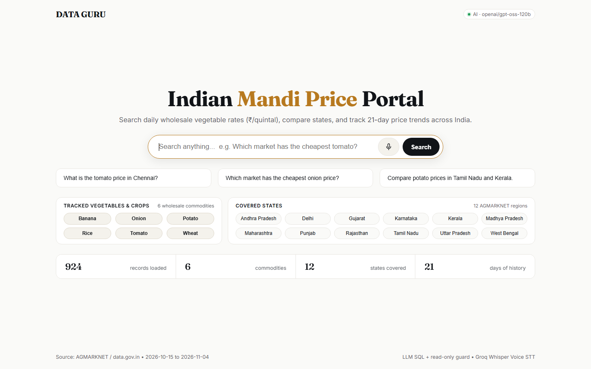
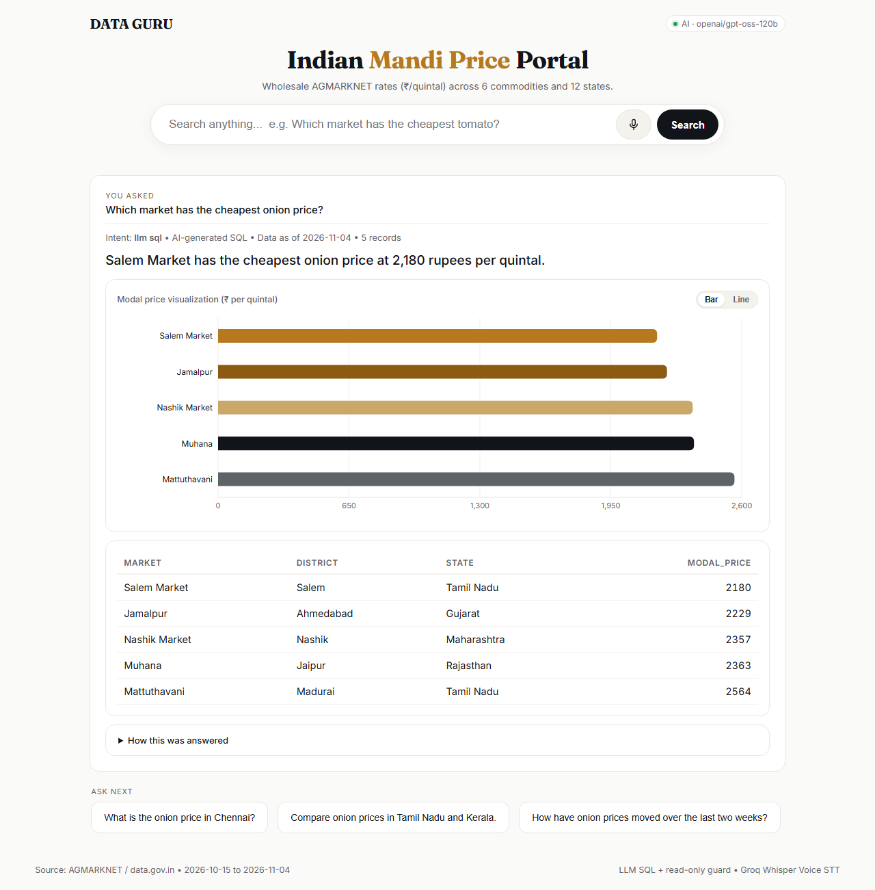
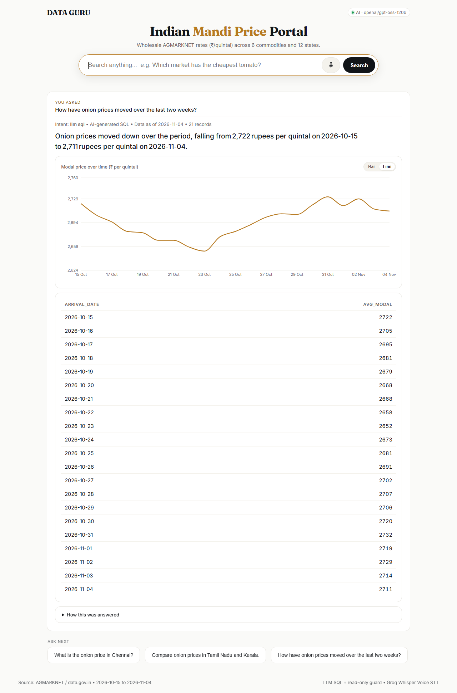
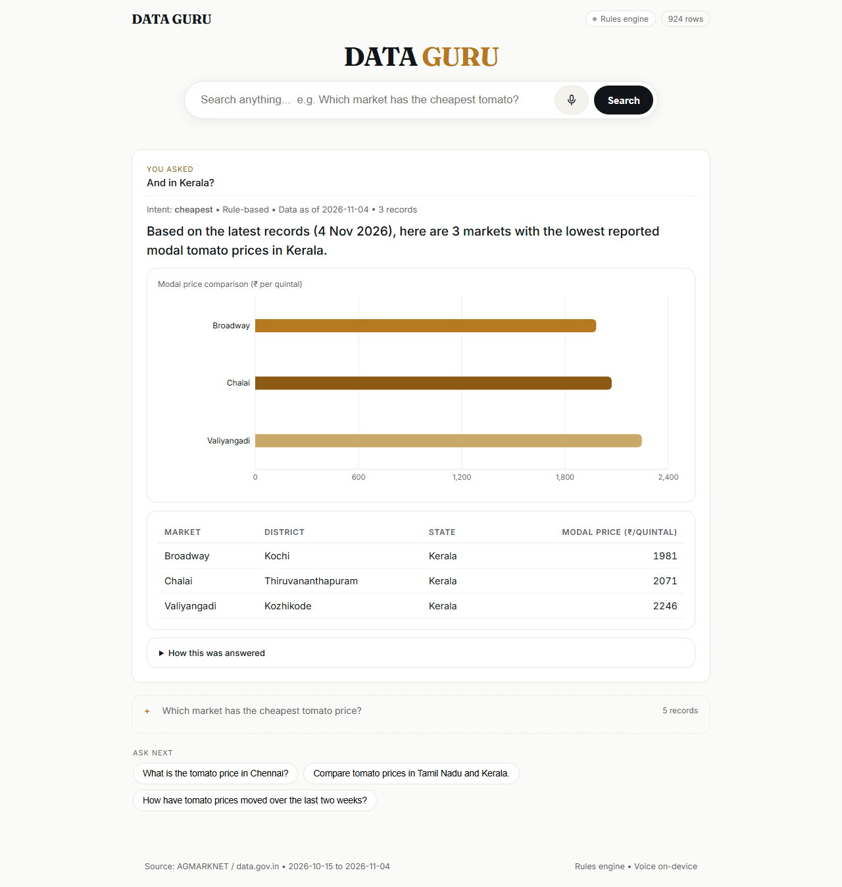

# DATA GURU — V2

Ask a question in plain English about Indian agricultural mandi prices and get an answer, a table
and a chart, from your own database.

**Runs with no API key.** Add one and the same app answers with LLM-generated SQL, live
data.gov.in prices, and AI-written sentences.

## Demo Video

Watch the complete video walkthrough of the portal — direct city price lookups, interactive Bar/Line chart switching, multi-turn conversational follow-ups, and the wholesale quintal-only policy:

<video src="https://github.com/Anirudh1017/data-guru/raw/main/docs/demo.mp4" controls="controls" width="100%" style="max-width: 100%;">
  Your browser does not support the video tag.
</video>

*(Or view directly on GitHub: [Watch demo.mp4](docs/demo.mp4))*
---

## Screenshots








---

## Clone & run (from scratch)
**Prerequisites** — Python 3.10+, Node 18+, Git.

```powershell
# 1. Clone
cd d:\    # any user directory
git clone https://github.com/Anirudh1017/data-guru.git
cd data-guru

# 2. Backend
cd backend
pip install -r requirements.txt
python seed_data.py          # 924 rows, 21 days, 6 commodities -> data_guru.db (gitignored, regenerated)
python -m uvicorn main:app --port 8000
# terminal 2:
cd frontend
npm install
npm run dev -- --host 127.0.0.1 --port 5173
```

Open http://127.0.0.1:5173

**One command (Windows):** just run `run.bat`.

> Note: The database file (`backend/data_guru.db`) and any `.env` files are **gitignored** — they are never pushed to GitHub. After cloning, always run `seed_data.py` to recreate the DB, and create your own `backend/.env` (see guide below).

---

## API keys — how to get each service

Copy the template and fill in what you need (all keys are optional — the app runs fine without them):

```powershell
cd backend
copy .env.example .env        # Windows: copy, Linux/macOS: cp .env.example .env
notepad .env                  # edit it
```

Open `backend/.env` and set any of the following. **Never commit this file** — it's already in `.gitignore`.

### 1. Groq (LLM + voice transcription) — recommended, free tier

- Sign up / sign in: https://console.groq.com
- Keys: https://console.groq.com/keys → **Create API key** → copy it (starts with `gsk_`)
- In `backend/.env`:
  ```
  LLM_PROVIDER=groq
  LLM_API_KEY=gsk_xxxxxx...
  LLM_MODEL=openai/gpt-oss-120b
  LLM_SUMMARY=true
  ```
- This single key powers both the LLM (`openai/gpt-oss-120b`) and voice (`whisper-large-v3-turbo`). No extra STT key needed.

### 2. OpenAI (alternative LLM provider)

- Key: https://platform.openai.com/api-keys → **Create new secret key**
- In `backend/.env`:
  ```
  LLM_PROVIDER=openai
  LLM_API_KEY=sk-xxxxxx...
  # LLM_MODEL=gpt-4o-mini   # optional, this is the default for openai
  ```

### 3. Other LLM providers (all optional)

Any OpenAI-compatible provider works. Set `LLM_PROVIDER` + `LLM_API_KEY`:

| Provider | Sign up / key | Default model |
|---|---|---|
| `groq` | https://console.groq.com/keys | `openai/gpt-oss-120b` |
| `together` | https://api.together.ai/settings/api-keys | `meta-llama/Llama-3.3-70B-Instruct-Turbo` |
| `openrouter` | https://openrouter.ai/keys | `openai/gpt-4o-mini` |
| `gemini` | https://aistudio.google.com/app/apikey | `gemini-2.0-flash` |
| `openai` | https://platform.openai.com/api-keys | `gpt-4o-mini` |

### 4. Ollama (fully local, no key, no internet needed for LLM)

```powershell
ollama pull llama3.1
```
```ini
LLM_PROVIDER=ollama
LLM_MODEL=llama3.1
```

### 5. data.gov.in — live AGMARKNET mandi prices (optional)

- Sign up: https://data.gov.in → **Register**
- After signing in: **My Account → API Key** → copy the key
- In `backend/.env`:
  ```
  DATA_GOV_API_KEY=xxxxxx
  ```
- Then sync live data: `cd backend && python fetch_daily.py`
- Schedule it daily via Task Scheduler to keep history growing.

### Which keys do I need?

| Goal | Keys to add |
|---|---|
| Just answer questions (rules engine) | none — works out of the box |
| AI-written answers + LLM → SQL | Groq key (or any LLM key above) |
| Voice questions (mic button) | Groq key (Whisper) — otherwise uses browser's built-in Web Speech (`en-IN`) |
| Live mandi prices (instead of seed data) | data.gov.in key |

### Restart after changing `.env`

Stop the backend (`Ctrl+C`) and start it again. `settings.py` loads `.env` at startup — no caching, every change needs a backend restart.

---

## Run it (quick commands)

Windows, one command:

```
run.bat
```

Or manually, two terminals:

```
cd backend
pip install -r requirements.txt
python seed_data.py          # 924 rows, 21 days, 6 commodities
python -m uvicorn main:app --port 8000

cd frontend
npm install
npm run dev -- --host 127.0.0.1 --port 5173
```

Open http://127.0.0.1:5173

## What V2 adds over V1

| Feature | Where |
|---|---|
| Ask by **voice** (Groq Whisper `whisper-large-v3-turbo` with VAD + Web Speech fallback) | mic button + `POST /api/transcribe` |
| First-class **conversation**: previous turns collapse, "And in Kerala?" reuses the commodity and intent | thread UI + `history` on `/api/ask` |
| **History and trends**: "How have onion prices moved..." renders a line chart | `trend` intent |
| **LLM → SQL** behind a read-only guard, with automatic fallback to rules | `backend/llm.py`, `backend/sql_guard.py` |
| Optional **AI-written answer** sentences | `LLM_SUMMARY` |
| **Live data sync** from data.gov.in, date-scoped upserts (re-running is safe) | `backend/fetch_daily.py` |
| Engine badge: shows *Rules engine* or the active AI model | top bar |
| "Ask next" chips after every answer | derived from intent + commodity |
| Richer dataset: 924 rows, 21 days, 12 states, 6 commodities | `seed_data.py` |

Still **no login, no Docker, no MySQL** — one SQLite file, exactly as you choose.

## The two engines

```
POST /api/ask  {question, history}
        │
        ├── LLM configured?  ── LLM writes a SELECT ── sql_guard validates
        │                                              │ single read-only SELECT over
        │                                              │ mandi_prices, LIMIT clamped to
        │                                              │ 200, step + time budget
        │                                              ▼
        │                                     run on a read-only SQLite connection
        │
        └── No LLM / unsafe SQL / provider down
                                                      │
                                                      ▼
                                            rule parser → query builder
```

The response shape is identical either way, so the UI, charts and conversation all work unchanged.
Any failure on the LLM path falls back to rules instead of erroring, and the response says which
engine answered: `"engine": "llm" | "rules"`.

## Safety model

The model can only ever **read**. `sql_guard.py` rejects stacked statements, comments, writes,
DDL, `PRAGMA`, other tables, and missing/oversized `LIMIT`s, then `execute_readonly()` runs the
query on a `mode=ro` connection with a step budget and a 5-second time budget. Test it with
`python test_v2.py` — it tries 7 attacks plus a malicious LLM response.

## Enable the extras (nothing else to install)

Copy `backend/.env.example` to `backend/.env`:

**LLM — any OpenAI-compatible provider**

```
LLM_PROVIDER=groq                # openai | groq | together | openrouter | ollama | gemini
LLM_API_KEY=...
```

`ollama` needs no key and runs fully on your machine:

```
ollama pull llama3.1
LLM_PROVIDER=ollama
LLM_MODEL=llama3.1
```

**Live mandi prices**

```
DATA_GOV_API_KEY=...             # free at data.gov.in
```

Then: `cd backend && python fetch_daily.py`. Run it daily from Task Scheduler to keep history
growing; it only replaces the dates it fetches, so older days survive.

**Voice (Speech-to-Text)**

When a Groq API key is configured (`LLM_PROVIDER=groq`), voice search records microphone audio with automatic Voice Activity Detection (VAD) and transcribes it via Groq `whisper-large-v3-turbo` (`POST /api/transcribe`), primed with Indian agricultural mandi vocabulary (`Koyambedu`, `Mattuthavani`, `Tamil Nadu`, `Kerala`, etc.). Without a key, it falls back seamlessly to the browser's Web Speech API (`en-IN`).
## What it answers

| You ask | Intent | Output |
|---|---|---|
| What is the tomato price in Chennai? | `price` | Latest modal price with min/modal/max |
| Which market has the cheapest onion price? | `cheapest` | Top 5 + bar chart |
| Compare the prices of potatoes in Tamil Nadu and Kerala. | `compare` | Average per state + chart |
| How have onion prices moved over the last two weeks? | `trend` | Line chart + start/end prices |
| **And in Kerala?** | follow-up | Inherits commodity + intent from previous turn |

## Tests

```
cd backend && python test_v2.py      # 38 checks: intents, trend, follow-ups, SQL guard, LLM fallback
cd backend && python test_sync.py    # 11 checks: data.gov.in pagination + normalisation (mocked)
cd frontend && node scripts/verify.mjs   # 26 browser checks: layout, charts, conversation, voice
```

## Project layout

```
backend/
  main.py          FastAPI app: /api/ask, /api/meta, /api/status, /api/health, /api/examples
  settings.py      Environment-driven config for keys and provider choices
  llm.py           LLM → SQL + LLM → sentence, over any OpenAI-compatible endpoint
  sql_guard.py     Validation + read-only execution for generated SQL
  parser.py        Rule-based question parser (intents, entities, follow-ups)
  queries.py       Query builders for rules + executor for generated SQL
  ingest.py        Shared CSV/API normalisation and date-scoped upserts
  fetch_daily.py   data.gov.in sync
  load_data.py     Any CSV → SQLite
  seed_data.py     Deterministic 21-day demo dataset
  test_v2.py  test_sync.py
frontend/
  src/App.tsx, api.ts, hooks/useSpeech.ts
  src/components/  ChartView (bar + line), ResultsTable, MicIcon
  scripts/verify.mjs
docs/
  V2-ROADMAP.md
```

## What's left (deliberately small)

- Multi-dataset search (one dataset per department, user picks a source)
- Persisted conversation history across sessions (currently in-memory per tab)
- Deployable packaging (the code is CORS + proxy friendly; a single `dist` + FastAPI works)

## Changelog

See [CHANGELOG.md](CHANGELOG.md) for the full release history:
- **v2.3.0:** Redesigned two-card bento directory (*Tracked Vegetables & Crops* `2×3` + *Covered States* `2×6`), compact centered search bar, single-line coverage metrics, and uniform vertical rhythm across the single-frame home view.
- **v2.2.0:** Multi-series trend and comparison charts, category-wide aggregate query support, persistent commodity and state quick-filter directory on result views, and wholesale quintal-only (`₹/quintal`) unit policy guidance.
- **v2.1.0:** Streamlined *Indian Mandi Price Portal* single-frame layout, interactive Bar/Line chart switcher across all query intents, and updated setup documentation.
- **v2.0.0:** Initial V2 release with LLM → SQL read-only guard, deterministic rules fallback, Groq Whisper voice search, multi-turn follow-ups, 21-day trend charts, and data.gov.in live sync.
